```{=html}
<div class="collab-grid">

  <div>
    <div class="collab-name">Pr. Cedric BOECKX</div>
    <div class="collab-links">
      <a href="https://twitter.com/cedricboeckx" title="Twitter/X"><i class="bi bi-twitter-x"></i></a>
    </div></div>

  <div>
    <div class="collab-name">Dr. Jeroen BUIL</div>
    <div class="collab-links">
      <a href="https://www.linkedin.com/in/jeroen-buil/" title="LinkedIn"><i class="bi bi-linkedin"></i></a>
    </div></div>

  <div>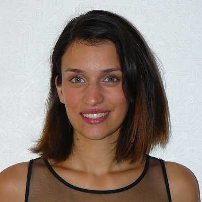
    <div class="collab-name">Dr. Charlotte DEFOLIE</div>
    <div class="collab-links">
      <a href="https://www.researchgate.net/profile/Defolie-Charlotte" title="ResearchGate"><i class="ai ai-researchgate"></i></a>
      <a href="https://scholar.google.com/citations?user=PknDP6MAAAAJ&hl=en" title="Google Scholar"><i class="ai ai-google-scholar"></i></a>
      <a href="https://twitter.com/Cha_Defolie" title="Twitter/X"><i class="bi bi-twitter-x"></i></a>
      <a href="https://www.linkedin.com/in/charlotte-defolie-phd-6907a0212/" title="LinkedIn"><i class="bi bi-linkedin"></i></a>
    </div></div>

  <div>
    <div class="collab-name">Dr. Jacob DUNN</div>
    <div class="collab-links">
      <a href="https://www.researchgate.net/profile/Jacob-Dunn-5" title="ResearchGate"><i class="ai ai-researchgate"></i></a>
      <a href="https://scholar.google.com/citations?user=HuVKJDEAAAAJ&hl=en" title="Google Scholar"><i class="ai ai-google-scholar"></i></a>
      <a href="https://twitter.com/JacobCDunn" title="Twitter/X"><i class="bi bi-twitter-x"></i></a>
    </div></div>

  <div>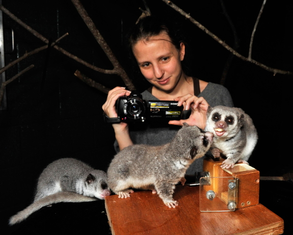
    <div class="collab-name">Dr. Anne-Claire FABRE</div>
    <div class="collab-links">
      <a href="https://www.researchgate.net/profile/Anne-Claire-Fabre" title="ResearchGate"><i class="ai ai-researchgate"></i></a>
      <a href="https://scholar.google.com/citations?user=3FQx05cAAAAJ&hl=en" title="Google Scholar"><i class="ai ai-google-scholar"></i></a>
      <a href="https://twitter.com/grumpyDrFabre" title="Twitter/X"><i class="bi bi-twitter-x"></i></a>
      <a href="https://anne-claire-fabre.weebly.com/" title="Website"><i class="bi bi-globe"></i></a>
    </div></div>

  <div>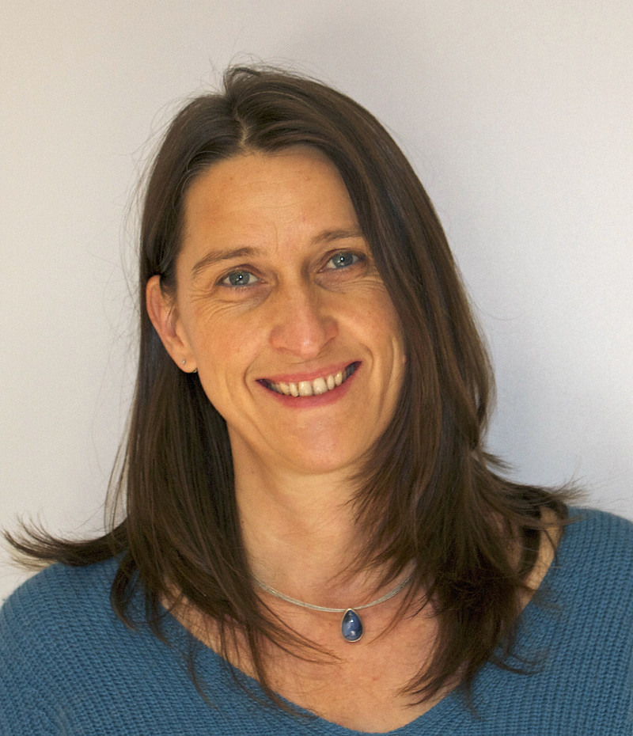
    <div class="collab-name">Dr. Claudia FICHTEL</div>
    <div class="collab-links">
      <a href="https://www.researchgate.net/profile/Claudia-Fichtel" title="ResearchGate"><i class="ai ai-researchgate"></i></a>
    </div></div>

  <div>
    <div class="collab-name">Dr. Julien HAMBUCKERS</div>
    <div class="collab-links">
      <a href="https://www.researchgate.net/profile/Julien-Hambuckers" title="ResearchGate"><i class="ai ai-researchgate"></i></a>
      <a href="https://scholar.google.com/citations?user=Hf_PdUkAAAAJ&hl=en" title="Google Scholar"><i class="ai ai-google-scholar"></i></a>
      <a href="https://www.linkedin.com/in/julienhambuckers/" title="LinkedIn"><i class="bi bi-linkedin"></i></a>
    </div></div>

  <div><div class="collab-initials">SH</div>
    <div class="collab-name">Dr. Séverine HEX</div>
    <div class="collab-links">
      <a href="https://scholar.google.com/citations?user=U6XWVcYAAAAJ&hl=en" title="Google Scholar"><i class="ai ai-google-scholar"></i></a>
    </div></div>

  <div>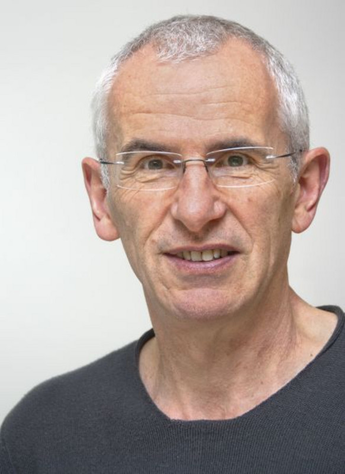
    <div class="collab-name">Pr. Peter KAPPELER</div>
    <div class="collab-links">
      <a href="https://www.researchgate.net/profile/Peter-Kappeler" title="ResearchGate"><i class="ai ai-researchgate"></i></a>
      <a href="https://scholar.google.com/citations?user=GAcL5ewAAAAJ&hl=en" title="Google Scholar"><i class="ai ai-google-scholar"></i></a>
    </div></div>

  <div><div class="collab-initials">CL</div>
    <div class="collab-name">Cristina M. LORENZI</div>
    <div class="collab-links">
      <a href="https://scholar.google.com/citations?user=mLi941wAAAAJ&hl=en" title="Google Scholar"><i class="ai ai-google-scholar"></i></a>
    </div></div>

  <div>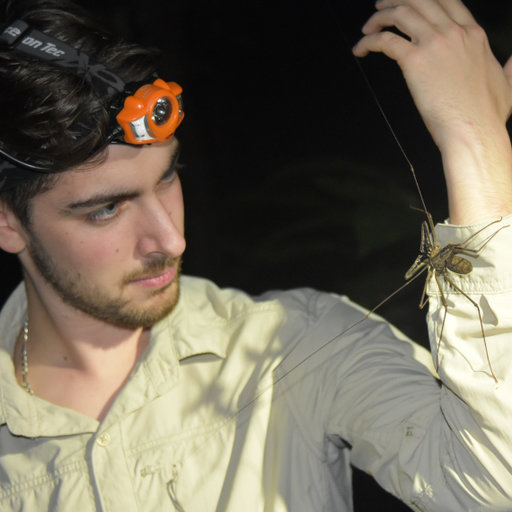
    <div class="collab-name">Aurélien LOWIE</div>
    <div class="collab-links">
      <a href="https://www.researchgate.net/profile/Aurelien-Lowie" title="ResearchGate"><i class="ai ai-researchgate"></i></a>
      <a href="https://scholar.google.com/citations?user=eB1GXDoAAAAJ&hl=en" title="Google Scholar"><i class="ai ai-google-scholar"></i></a>
    </div></div>

  <div>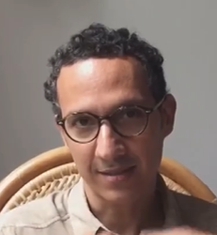
    <div class="collab-name">Dr. Juan PARRA VERGARA</div>
    <div class="collab-links">
      <a href="https://www.researchgate.net/profile/Juan-Parra-20" title="ResearchGate"><i class="ai ai-researchgate"></i></a>
      <a href="https://scholar.google.com/citations?user=USDYbtIAAAAJ&hl=en" title="Google Scholar"><i class="ai ai-google-scholar"></i></a>
    </div></div>

  <div>
    <div class="collab-name">Pr. Emmanuelle POUYDEBAT</div>
    <div class="collab-links">
      <a href="https://www.researchgate.net/profile/Emmanuelle-Pouydebat-2" title="ResearchGate"><i class="ai ai-researchgate"></i></a>
      <a href="https://scholar.google.com/citations?user=Vry0qwcAAAAJ&hl=en" title="Google Scholar"><i class="ai ai-google-scholar"></i></a>
      <a href="https://www.linkedin.com/in/emmanuelle-pouydebat-0aa01979/" title="LinkedIn"><i class="bi bi-linkedin"></i></a>
    </div></div>

  <div>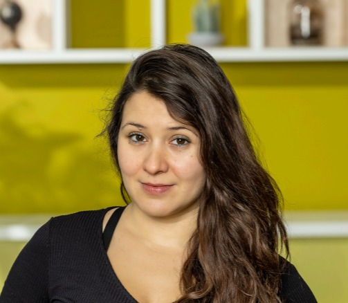
    <div class="collab-name">Dr. Limor RAVIV</div>
    <div class="collab-links">
      <a href="https://www.researchgate.net/profile/Limor-Raviv" title="ResearchGate"><i class="ai ai-researchgate"></i></a>
      <a href="https://scholar.google.com/citations?user=e2Owtd4AAAAJ&hl=en" title="Google Scholar"><i class="ai ai-google-scholar"></i></a>
      <a href="https://twitter.com/limor_raviv" title="Twitter/X"><i class="bi bi-twitter-x"></i></a>
    </div></div>

  <div>
    <div class="collab-name">Dr. Alejandro RICO-GUEVARA</div>
    <div class="collab-links">
      <a href="https://www.researchgate.net/profile/Alejandro-Rico-Guevara" title="ResearchGate"><i class="ai ai-researchgate"></i></a>
      <a href="https://scholar.google.com/citations?user=73xup1sAAAAJ&hl=en" title="Google Scholar"><i class="ai ai-google-scholar"></i></a>
      <a href="https://twitter.com/ecophysicslab" title="Twitter/X"><i class="bi bi-twitter-x"></i></a>
    </div></div>

  <div>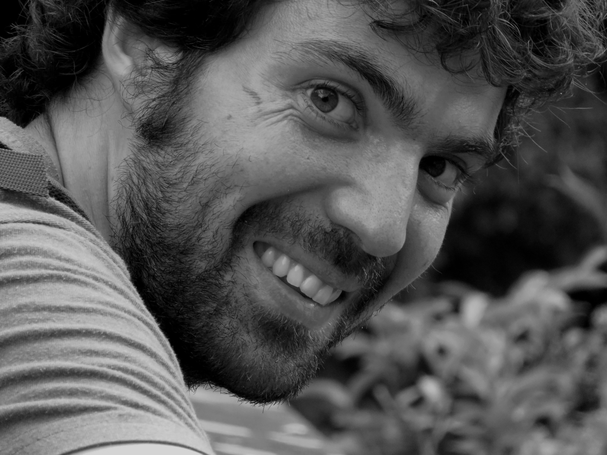
    <div class="collab-name">Dr. Lluís SOCIAS MARTÍNEZ</div>
    <div class="collab-links">
      <a href="https://www.researchgate.net/profile/Lluis-Socias-Martinez-2" title="ResearchGate"><i class="ai ai-researchgate"></i></a>
      <a href="https://scholar.google.com/citations?user=wTreZucAAAAJ&hl=en" title="Google Scholar"><i class="ai ai-google-scholar"></i></a>
    </div></div>

  <div>
    <div class="collab-name">Pr. Christine WALL</div>
    <div class="collab-links">
      <a href="https://www.researchgate.net/profile/Christine-Wall-3" title="ResearchGate"><i class="ai ai-researchgate"></i></a>
      <a href="https://scholar.google.com/citations?user=VlrYas0AAAAJ&hl=en" title="Google Scholar"><i class="ai ai-google-scholar"></i></a>
    </div></div>

  <div>
    <div class="collab-name">Dr. Ian WHISHAW</div>
    <div class="collab-links">
      <a href="https://www.researchgate.net/profile/Ian-Whishaw" title="ResearchGate"><i class="ai ai-researchgate"></i></a>
      <a href="https://scholar.google.com/citations?user=KP7mXc4AAAAJ&hl=en" title="Google Scholar"><i class="ai ai-google-scholar"></i></a>
    </div></div>

</div>
```

## Books by collaborators

::: {.book-row}
[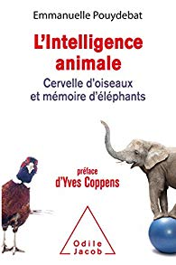{fig-alt="L'intelligence animale"}](https://www.babelio.com/livres/Pouydebat-Lintelligence-animale/929177)
[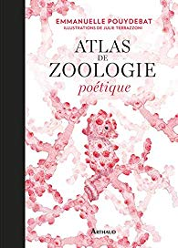{fig-alt="Atlas de zoologie poétique"}](https://www.babelio.com/livres/Pouydebat-Atlas-de-zoologie-poetique/1079381)
[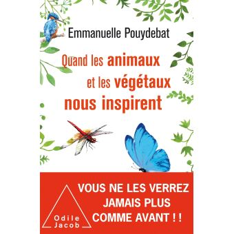{fig-alt="Quand les animaux et les végétaux nous inspirent"}](https://livre.fnac.com/a13700532/Emmanuelle-Pouydebat-Quand-les-animaux-et-les-vegetaux-nous-inspirent)
[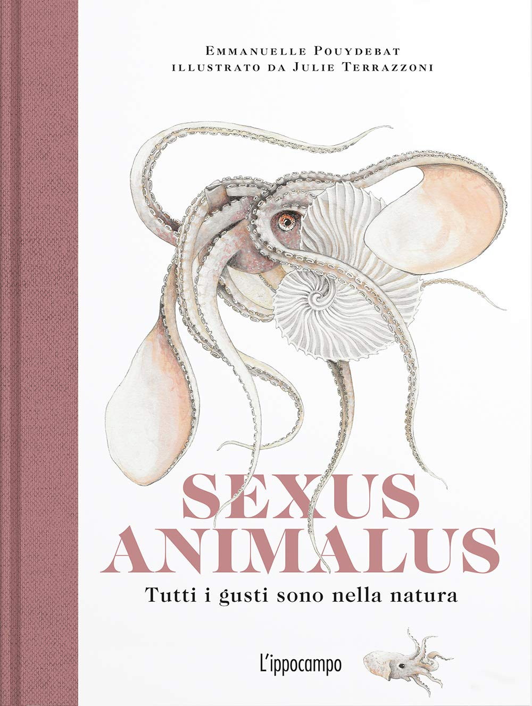{fig-alt="Sexus animalus"}](https://www.arthaud.fr/sexus-animalus/9782081470453)
:::
