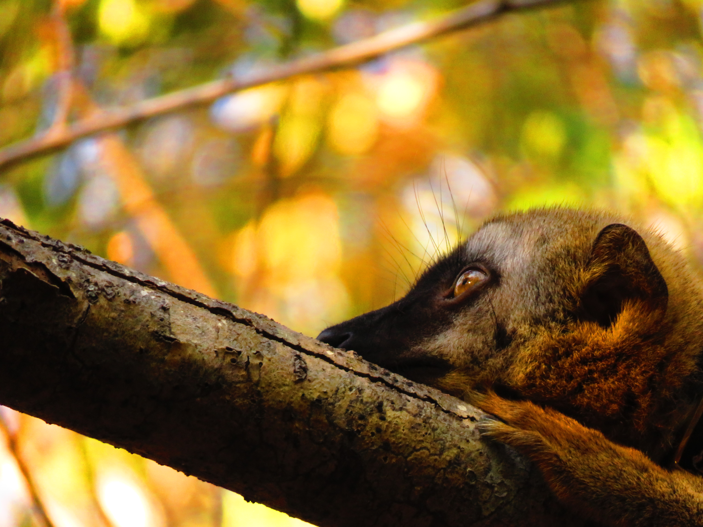

My research investigates the evolution of social behavior and communication across species, with a focus on how social and ecological factors shape signaling strategies. I am particularly interested in multimodal communication, the interplay between communicative and social complexity, and the cognitive and functional underpinnings of behavioral diversity. I combine observational, experimental, and comparative approaches to explore these questions across a broad range of taxa, including vertebrates and invertebrates. I also contribute to teaching and mentoring in behavioral biology and ethology.

[**My research in keywords:** Evolution – Communication – Sociality – Multimodality – Grasping abilities]{.keywords}

### Contact

<i class="bi bi-envelope"></i> [louise.peckre@sorbonne-paris-nord.fr](mailto:louise.peckre@sorbonne-paris-nord.fr)  
<i class="bi bi-envelope"></i> [louise.peckre@univ-paris13.fr](mailto:louise.peckre@univ-paris13.fr)  
<i class="bi bi-envelope"></i> [louise.peckre@outlook.com](mailto:louise.peckre@outlook.com)

::: {.contact-links}
<a href="https://scholar.google.de/citations?user=MVCrp_MAAAAJ&hl=en" title="Google Scholar"><i class="ai ai-google-scholar"></i></a>
<a href="https://www.researchgate.net/profile/Louise_Peckre" title="ResearchGate"><i class="ai ai-researchgate"></i></a>
<a href="https://orcid.org/0000-0002-0065-8529" title="ORCID"><i class="ai ai-orcid"></i></a>
:::

{fig-alt="Lemurs in the field" style="width:100%; border-radius:6px; margin-top:1.5rem;"}
