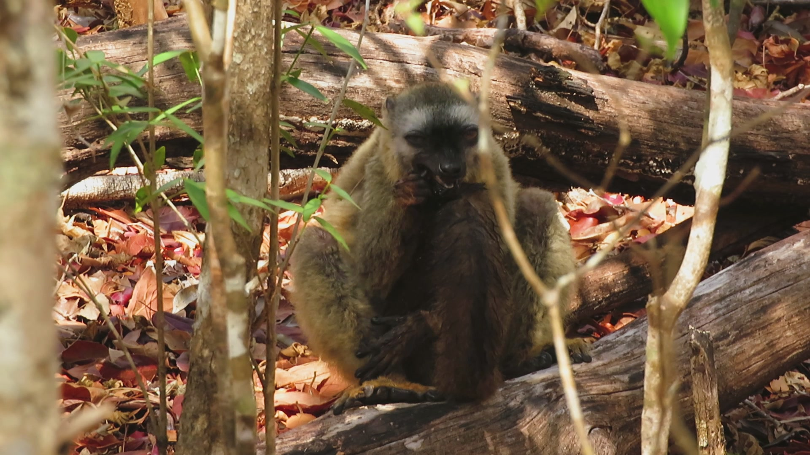

{fig-alt="Fieldwork" style="width:100%; max-width:700px; border-radius:6px;"}

## Self-medication using millipedes? {#self-medication}

::: {.project-card}
{fig-alt="Red-fronted lemur anointing with a millipede"}

::: {}
Watch the red-fronted lemurs in action!

- Read the article in [*Biosphère* magazine](https://drive.google.com/file/d/1T8zJD4k6ZdQ9tQX19Q6RdcmkSV7X50m_/view?usp=sharing)
- Read the [DPZ report](https://www.dpz.eu/en/home/single-view/news/lemuren-behandeln-magen-darm-beschwerden-mit-tausendfuesslern-1.html) or watch the [DPZ-talk video](https://www.youtube.com/watch?v=Wib3ItcbZ04)
- Time for a comic break? [Read the comic (PDF)](https://697de1c9-7636-4189-a973-c4d545757661.filesusr.com/ugd/0976b8_045305ae325c442a97e39d84309f2d54.pdf)
- [Video of the lemurs](https://drive.google.com/open?id=19bCFl3al68-Z1Rpt0PYYfjt2ZO0gSvb4)
:::
:::



## Listen and guess who I am? {#listen}

**Coolest Sound Recording** award, XXVII International Bioacoustics Council (IBAC 2019).

<!-- Ajoutez votre enregistrement ici, par exemple :
<audio controls src="files/listen-and-guess.mp3"></audio>
-->

## Curso Raíces de lo Humano {#curso}

<!-- Ajoutez ici la description et les visuels du cours -->
