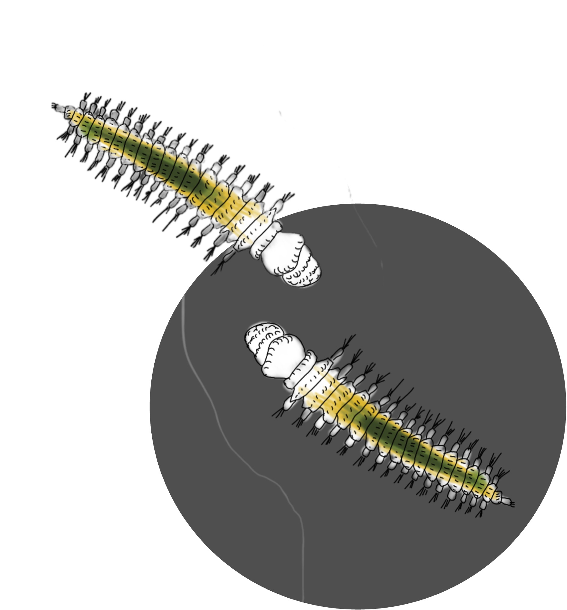
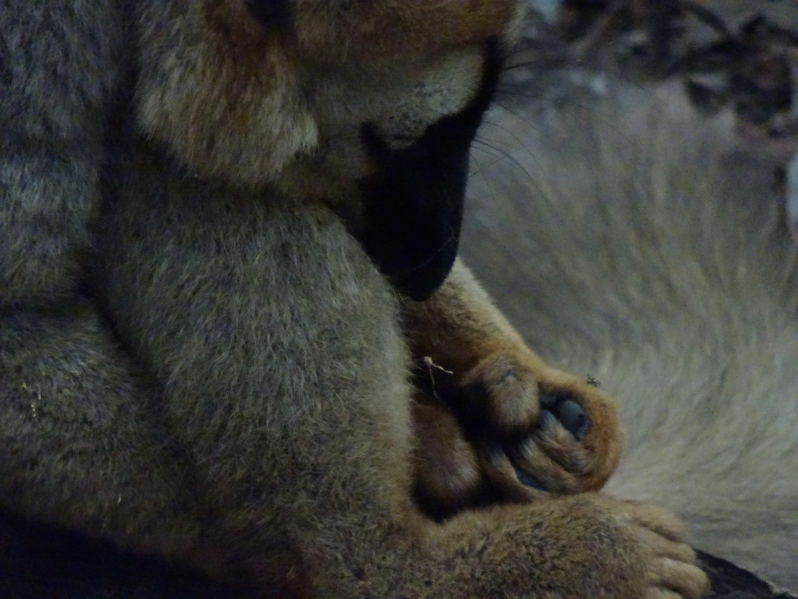
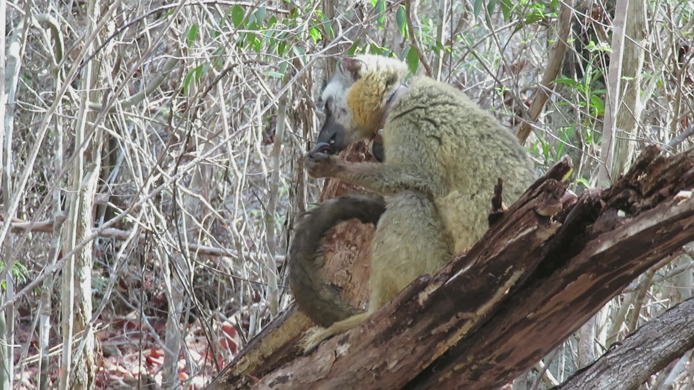

[Social worms](#socialworms) · [Communicative & social complexity](#complexity) · [Evolution of grasping abilities](#grasping) · [Self-medication?](#selfmedication) · [Releasable collar](#collar)

::: {.project-card #socialworms}
{fig-alt="Worms"}

::: {}
## SOcial WORMs

#### An experimental approach to the social puzzle across sexual systems

[January 2026 – present]{.project-meta}

**Laboratoire d'Ethologie Expérimentale et Comparée (LEEC)**, Université Sorbonne Paris Nord  
Funded by the « Appel à Projets de la Commission de la recherche USPN » (10k€)
:::
:::

## Communicative complexity {#complexity .project-group}

::: {.project-card .project-card-sub #coconet}
[]{.img-placeholder}

::: {}
### COCONET

#### Combining Comparative Network approaches to explore multimodal communication in zebras and beyond

[January 2027 –]{.project-meta}

**Laboratoire d'Ethologie Expérimentale et Comparée (LEEC)**, Université Sorbonne Paris Nord  
In collaboration with Séverine Hex (Harvard University) and the Réserve Africaine de Sigean
:::
:::

::: {.project-card #lemurs}
{fig-alt="Lemurs"}

::: {}
### Sociality and multimodal communication in two lemur species

[PhD Project · November 2015 –]{.project-meta}

**Deutsches Primatenzentrum** (German Primate Center), Göttingen  
Funded by the Deutsche Forschungsgemeinschaft (DFG)

Related: [Peckre et al. 2018](https://doi.org/10.1007/s00265-018-2605-4) · [Peckre et al. 2022](https://doi.org/10.1038/s41598-022-08861-2) · [Peckre et al. 2025](https://doi.org/10.1016/j.anbehav.2025.123163) · [PhD dissertation](https://ediss.uni-goettingen.de/handle/21.11130/00-1735-0000-0008-57D0-B)
:::
:::

::: {.project-card #grasping}
{fig-alt="Strepsirrhine grasping food"}

::: {}
## The evolution of grasping abilities in Strepsirrhines

[Master Project · January 2015 – 2023]{.project-meta}

**Muséum National d'Histoire Naturelle**, Paris (CNRS), in collaboration with the Duke Lemur Center

Related: [Peckre et al. 2016](https://doi.org/10.1038/srep37729) · [Fabre et al. 2018](https://doi.org/10.1093/biolinnean/bly188) · [Peckre et al. 2019a](https://doi.org/10.1093/biolinnean/bly215) · [Peckre et al. 2019b](https://doi.org/10.1242/jeb.207688) · [Peckre et al. 2023](https://doi.org/10.1007/s11692-023-09598-0)
:::
:::

::: {.project-card #selfmedication}
{fig-alt="Red-fronted lemur with millipede"}

::: {}
## Potential self-medication using millipede secretions in red-fronted lemurs

#### Combining anointment and ingestion for a joint action against gastrointestinal parasites?

[Side Project · 2016 –]{.project-meta}

**Deutsches Primatenzentrum**, Göttingen

Related: [Peckre et al. 2018](https://doi.org/10.1007/s10329-018-0674-7) · [Outreach](outreach.qmd#self-medication)
:::
:::

::: {.project-card #collar}
{fig-alt="Releasable collar"}

::: {}
## Remotely releasable-collar mechanism for mammals

#### An affordable technology to avoid multiple captures

[Side Project · 2015]{.project-meta}

**Deutsches Primatenzentrum**, Göttingen

Related: [Buil, Peckre et al. 2019](https://doi.org/10.2981/wlb.00581)
:::
:::
